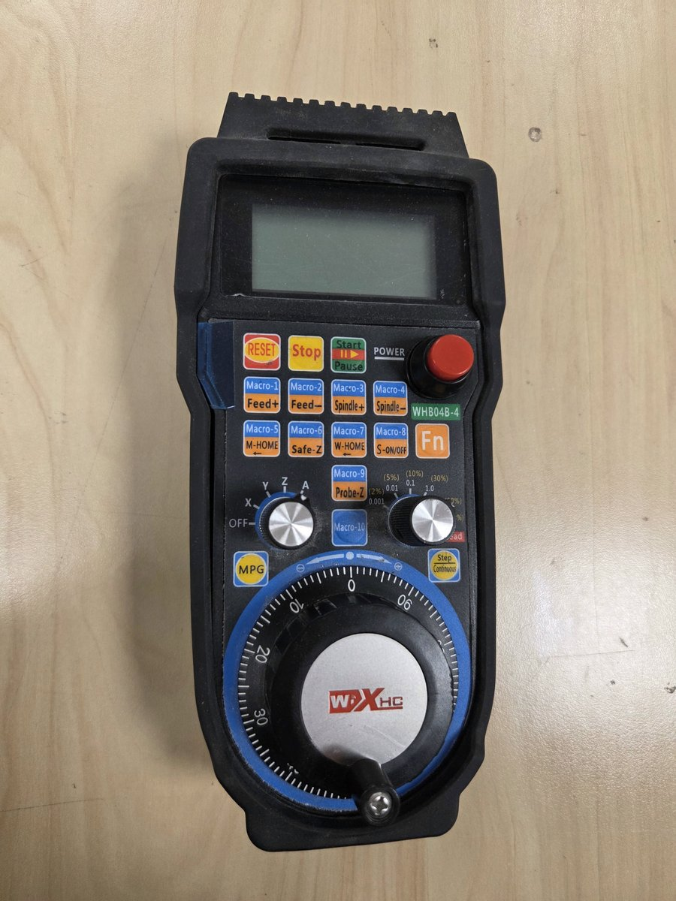
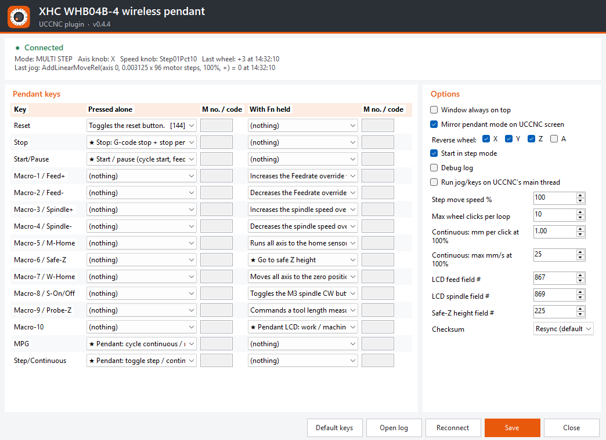

# XHC WHB04B-4 wireless pendant plugin for UCCNC

A UCCNC plugin for the **XHC WHB04B-4** wireless MPG pendant (USB dongle
`VID_10CE&PID_EB93`). It was built for a StepCraft M700, but it works with any
UCCNC machine.

**Website:** <https://ravo10.github.io/XHC-WHB04-4-UCCNC-Plugin/> ·
**Download:** [latest release](https://github.com/ravo10/XHC-WHB04-4-UCCNC-Plugin/releases/latest)



UCCNC's own "XHC-HB04" plugin is for the older **wired** HB04 (PID `EB70`),
which uses a different USB protocol. That plugin can't read the wireless pendant.

> **Status:** tested on a StepCraft M700 with UCCNC. Keys, step jogging, the LCD and
> the UCCNC screen sync work. The smooth continuous mode with verified stop (v0.4.6) is new and
> still being tested. Keep the E-stop within reach.



## What works

| Pendant | Default action |
|---------|----------------|
| RESET | UCCNC Reset toggle (button 144) |
| Stop | Stops G-code (130), drops pending pendant moves and presses UCCNC's jog-mode-stepping button (162) |
| Start/Pause | Cycle start when idle, otherwise feed hold / resume |
| Fn + Macro-1 / Macro-2 | Feed override + / − (132 / 133) |
| Fn + Macro-3 / Macro-4 | Spindle override + / − (134 / 135) |
| Fn + Macro-5 (M-HOME) | Home all (113) |
| Fn + Macro-6 (Safe-Z) | `G0 Z<safe Z>` (field 225), only when idle |
| Fn + Macro-7 (W-HOME) | Go to work zero (131) |
| Fn + Macro-8 (S-ON/OFF) | Spindle on/off (114) |
| Fn + Macro-9 (Probe-Z) | Tool length measurement, M31 (196) |
| Fn + Macro-10 | LCD toggles work ↔ machine coordinates (X ↔ X1) |
| Macro-1 … Macro-10 alone | Nothing by default. Set any UCCNC button code or G/M-code in the settings |
| MPG | Cycles continuous → multi step → single step (like the UCR201 pendant) |
| Step/Continuous | Toggles step ↔ continuous |
| Axis knob OFF/X/Y/Z/A | Selects the jog axis (OFF = wheel does nothing) |
| Speed knob | Step modes: 0.001 / 0.01 / 0.1 / 1.0 per click; 60 % and 100 % also step 1.0 (single step: max one step per 0.2 s). Continuous: smooth jog at 2 / 5 / 10 / 30 / 60 / 100 % speed while the wheel turns |
| Wheel | Jogs the selected axis |
| LCD | X/Y/Z (or A/B/C) position, CONT/STEP mode, feed and spindle values |

Every key can be changed in **Config → Configure plugins → XHC WHB04B-4 →
Configure/Show**. Each key, pressed alone and with Fn, has a dropdown with:
- nothing,
- run a macro (type the M number, e.g. `20000` → `M20000`),
- run any G/M-code you type,
- a built-in pendant action (start/pause, safe Z, step/continuous, zero axis,
  work/machine coordinates on the LCD),
- any UCCNC screen function, by name.

The plugin also presses UCCNC's own Continuous/Step, step-size and X/Y/Z/A jog
buttons, so the UCCNC screen follows the pendant. The button codes are looked up
by name in UCCNC's button list, which is saved to
`Plugins\XHC-WHB04B-4_uccnc_buttons.txt`.

Settings are saved in the UCCNC profile under section `[WHB04B]`.

### Safety: how continuous mode stops

Continuous mode jogs smoothly with UCCNC's `JogOnSpeed` while the wheel turns. A plugin
cannot stop that jog with speed 0. Testing showed that pressing UCCNC's *jog mode stepping*
and *MPG multi* buttons does stop it, so the plugin stops the jog that way 0.25 s after the
last wheel click, or at once when you press Stop. **Every stop is checked against the
machine position.** If the axis is still moving after 0.3 s the stop is sent again, and after
0.8 s the plugin presses UCCNC **Reset**.

If you untick *Smooth continuous jog*, continuous mode instead sends short fixed-length,
rate-limited moves. These always stop, but the motion is not smooth.

## Install

**Tested on Windows 11** with UCCNC on a StepCraft M700.

**No driver needed.** The pendant's wireless USB receiver (433 MHz radio, not Bluetooth)
is plug and play. Windows sets it up automatically as a standard USB HID device the first
time you plug it in. The XHC CD and its Mach3 driver are not needed for UCCNC.

1. Download `XHC-WHB04B-4_pendant.dll` from the
   [latest release](https://github.com/ravo10/XHC-WHB04-4-UCCNC-Plugin/releases/latest),
   or build it yourself (below).
2. Close UCCNC. Copy the DLL into `C:\UCCNC\Plugins\`.
   **Do not** copy any `Plugininterface.dll` from this project; UCCNC has its own.
3. Start UCCNC → **Config → Configure plugins**, then tick *enabled* (and *call
   startup*) for "XHC WHB04B-4 wireless pendant". Restart UCCNC when asked.
4. Disable the old "XHC-HB04 pendant" plugin so the two don't compete for the
   dongle.
5. Plug in the wireless USB receiver and switch the pendant on.

## Testing

Test in this order, with the machine's E-stop within reach:

1. **Without UCCNC:** run `Whb04bTest.exe` (in the same build artifact). It lists
   the XHC devices, prints every key, knob and wheel event, and shows a fake
   position on the pendant LCD that follows the wheel. Use `Whb04bTest.exe
   --raw` to also print the raw bytes. If keys and the LCD work here, the USB
   side is correct.
2. **In UCCNC:** enable *Debug log* in the plugin settings. The log is
   `C:\UCCNC\Plugins\XHC-WHB04B-4_pendant.log` (there is an "Open log" button).
   Try the wheel in STEP mode at 0.01 first, with the axis knob on each axis.
3. If a button does the wrong thing (most likely candidates: feed/spindle
   override direction, probe Z, safe Z), change its code in the settings, or
   send me the log.

## Build

Needs the .NET SDK (6 or newer) on Windows. The projects target .NET Framework
4.0, which is what UCCNC loads.

```bash
dotnet build src/WHB04B_pendant/WHB04B_pendant.csproj -c Release
```

```bash
dotnet build tools/Whb04bTest/Whb04bTest.csproj -c Release
```

## Publishing a release

On GitHub, open **Actions → build → Run workflow**, enter a version such as `v0.4.4`, and
run it on `main`. The workflow builds the plugin, creates the tag and publishes a release with
the DLL and a zip containing the test tool. Pushing a `v*` tag does the same.

## Repository layout

| Path | What |
|------|------|
| `src/Whb04b.Core/` | USB HID access and the WHB04B protocol (no UCCNC dependency) |
| `src/WHB04B_pendant/` | The UCCNC plugin (`Plugins.UCCNCplugin`) |
| `src/Plugininterface.Stub/` | Compile-only stand-in for UCCNC's `Plugininterface.dll` |
| `tools/Whb04bTest/` | Console hardware test tool |
| `tools/Screenshots/` | Renders the settings window with demo data (run by the `screenshots` workflow) |
| `tools/make_icon.py` | Generates the plugin icon |
| `docs/index.html` | GitHub Pages website |
| `docs/PROTOCOL.md` | The pendant's USB protocol, reverse-engineered from the Mach3 driver |
| `docs/UCCNC_API.md` | The UCCNC plugin API, as used by the stock plugins |
| `reference/` | Which third-party files were analysed and where to get them (not included) |

## Disclaimer

This is an independent project. It is not affiliated with or endorsed by XHC
(ChengDu XinHeCheng Technology) or CNCdrive. XHC, WHB04B, UCCNC and StepCraft are
trademarks of their respective owners. Use at your own risk, and keep the E-stop within reach.
